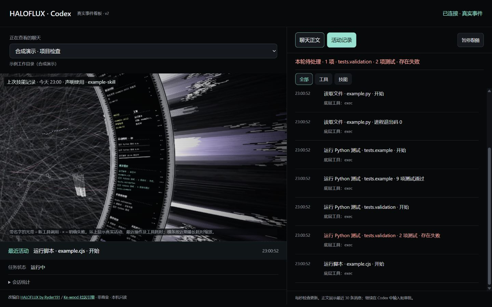

# HALOFLUX · Codex

<p align="center">
  <a href="./README.md"></a>
  <a href="./README.en.md"></a>
</p>

A **standalone live dashboard** that maps local Codex session activity onto the HALOFLUX light ring. Watch its half-ring composition, camera motion, actions, targets and results, with chat and activity records alongside it.

**Preview `0.1.0-preview.1` · Node.js 22+ · No third-party runtime dependencies · Noncommercial use only**



*The preview uses only synthetic events and example filenames, not real conversations or training data.*

This unofficial Codex adaptation modifies HALOFLUX and reuses the DeepSeek Harness community edition's Canvas engine. It reads local logs: **it is neither a built-in Codex plugin nor a DeepSeek Harness plugin bundle**, and it does not replace the Codex desktop application's background.

## Quick start

1. Install [Node.js 22 or later](https://nodejs.org/).
2. Download and extract this repository's ZIP, or download a package from Releases.
3. **Windows: double-click `start.cmd`.** The server opens your browser automatically. Keep its terminal window open; press `Ctrl+C` to stop it.
4. Use Codex normally and select the corresponding session in the dashboard.

Alternatively, start it from a terminal. There is no need to run `npm install`:

```sh
git clone https://github.com/mobiusw/haloflux-codex.git
cd haloflux-codex
node cli.cjs --open
```

The default URL is `http://127.0.0.1:43127/`. Run `node cli.cjs` to start without opening a browser. If npm is installed, `npm start` is also available.

### Custom log directory and port

The server reads the directory specified by `CODEX_HOME`, falling back to the current user's `~/.codex`:

```text
<Codex home>/
├── sessions/                # Recursively scanned rollout JSONL files
└── session_index.jsonl      # Optional session titles
```

```sh
node cli.cjs --port 43128 --codex-home "your Codex home directory" --open
node cli.cjs --help
```

`--codex-home` must point to the directory containing `sessions`, not to `sessions` itself. Session discovery also works without the index file, using user messages in the log as fallback titles. An empty state appears when no logs exist; start a Codex conversation and the dashboard will check again automatically. Directories are rescanned approximately every 10 seconds; the page requests the selected session's state approximately once per second.

The server listens only on `127.0.0.1`; LAN and public access are not supported. Local runtime acceptance was performed on Windows. The repository includes a Node 22/24 CI matrix for Windows, macOS and Linux; consult actual CI and local results for other desktop configurations.

## Current features

| Feature | Current behavior |
|---|---|
| Session selector | Lists up to 25 most recently modified sessions, including titles and working directories; remembers the browser's last selection |
| Chat text | Shows the last 30 user/assistant messages as plain text; Markdown is not rendered as rich text |
| Activity history | Keeps the latest 160 events; filters for all events, tools or skills; shows timestamps, actions, targets, results and underlying tool names |
| Following and pausing | Follows new records when near the bottom; pausing affects only the dashboard, not Codex or running commands |
| Latest activity | Shows the most recent event and timestamp; click to open activity history |
| Session state | Shows running, completed, interrupted or failed states from logs; a running task without new logs for two minutes displays “waiting for new logs” |
| Collapsible statistics | Tool call count, completed call count, logged cumulative tokens and last event time |
| Animated ring | Half-ring composition, automatic camera motion, beams and a background network; new tools trigger beams, and explicit failures can produce × markers |
| Semantic panels | Rotates through skill evidence, history reads, current request, latest reply, tools, results and current-turn pending issues |
| Recent actions | Merges recent identical actions and targets, showing up to three categories; unrecognized operations retain generic names |
| Activity duration | Shows recent call durations in seconds; updates while running and freezes on completion; bars are scaled to the longest recent duration |
| New-event highlighting | Brief silver/lilac highlights and `NEW` labels for changed panel content; initialization and resume do not mark old events as new |
| Width adaptation | Measures text to wrap or truncate it, retains dotted separators, and stacks the layout in narrow windows |
| Quiet history loading | Initial load, refresh, session switching and pause/resume do not replay old tool beams |
| Animation pausing | Pausing or connection loss stops animation; respects the system's reduced-motion preference |

### Where the ring's text comes from

- **skill:** Extracted from explicit assistant skill declarations and matched successful `SKILL.md` reads. Identical names are merged, retaining the latest three distinct skills. “Declared use” and “instructions read” represent different evidence; reading instructions does not prove their advice was applied. This is not a complete skill audit and can miss events.
- **History reads:** Recognizes some `read_thread` calls and displays a resolvable session title, requested scope and timestamp. Matched memory-file reads are labeled “local memory file.” It does not expose hidden memory or reasoning text, or automatically identify every context source.
- **Current request / latest reply:** Short excerpts from recent messages; can extract the request following `My request` in attachment messages.
- **Tools:** Recognized action, actual target file/test module, and logged status or result summary.
- **Operation results:** Prefers a recent recognized test summary; otherwise shows the latest explicit process result. A result may remain from a previous turn and is not necessarily new in the current turn.
- **Current-turn pending issues:** Only explicit failures in the current turn with a recognized target and a reliably matchable retry command. Up to three are included in rotating ring panels; the right-side entry shows the current-turn count.

Panels rotate and alternate, so they are not necessarily visible simultaneously and do not replace the activity list. Skill evidence and history reads may persist across turns; use their timestamps to distinguish old records from new ones.

### Recognized operations

Recognition uses tool names and a limited set of command rules, not additional model calls.

| Input form | Displayed information |
|---|---|
| Ordinary file reads with `Get-Content` / `cat` | Read file · `example.py`; quoted paths support spaces and Chinese characters |
| Matched reads of `skills/<name>/SKILL.md` | Read skill · `skill-name` |
| A direct `apply_patch` call | Modify files · `example.py` |
| Matched test filenames such as `node example.test.cjs` | Run tests · `example.test.cjs` |
| `node --check example.js` | Syntax check · `example.js` |
| `node example.cjs` | Run script · `example.cjs` |
| `python -m unittest tests.example`, `python -m pytest tests/example.py`, `pytest …` | Run Python tests · target; also supports some `py` and explicit Python executable forms |
| A test command passing an `.ipynb` path as a separate argument | Run Notebook tests · filename |
| `python -c` code containing `exec(...)`, followed by a separate `.ipynb` path argument | Run Notebook · filename |
| Matched browser open, reload and screenshot calls | Open page / reload page / view screenshot |
| Multiple child tools in one orchestration call, or detected compound shell commands | Batch tool call / batch command; an overall failure is not attributed to the first target |
| Other forms | Run command / call tool, retaining the underlying tool name for verification |

The Notebook rules are not tied to a particular filename, but they do require a supported launch command. Clicking “Run cell” directly in Jupyter or VS Code generally does not produce a Codex call event that this dashboard can recognize.

**An English README does not change the interface language.** The dashboard's current labels and generated action descriptions are primarily Chinese; the descriptions in this table explain their meaning.

### Results and pending issues

- Parses structured exit codes, explicit error flags and some command completion metadata. The word `error` in ordinary output, or a code sample containing `exit_code: 1`, is not enough by itself to establish failure.
- For recognized test operations, extracts counts from standard `unittest` and some `pytest` summaries, such as “9 tests passed.” Other frameworks generally show only the process exit code.
- **Exit code 0 does not prove business correctness.** Without reliable evidence, the result remains “unconfirmed,” rather than being treated as successful.
- An explicitly successful retry of the exact same command in the same working directory removes its pending issue and adds a “resolved” event. Rewritten commands are not automatically inferred to be the same operation, and unrelated successful commands do not clear it.
- Previous-turn failures do not appear as current-turn pending issues. Failure and resolution history remains subject to the latest-160-event limit. Failures with unknown targets, batch orchestration or no reliable retry identifier remain only in activity history.
- Dedicated “waiting for approval” and “waiting for user input” states are not implemented; a long gap without logs is not classified as a hang.

## Data fidelity and limitations

1. **Actual data layer:** Messages, tool calls, timestamps, recognized skill/history-read evidence and token fields come from local Codex JSONL files. Events absent from those files cannot be observed.
2. **Visual layer:** The network, particles, beam shapes, brightness and camera motion are procedurally generated artistic effects. They do not represent neurons, thinking intensity, completion percentage or training quality. SIM waveforms/random hexadecimal panels are absent, and the added step dial and phase ring are disabled.
3. **Not a model-training dashboard:** No epoch, loss, RankIC, gradient or trading-metric integration; no automatic Notebook execution or training functionality.
4. **Update timing:** The selected session is polled approximately every second and parsed incrementally. End-to-end latency depends on when Codex writes logs; this is not a live model token stream.
5. **Metric semantics:** Durations include outer-tool/process overhead. A completed call is not the same as a completed task. Cumulative tokens display the logged field directly, not a price, bill or net per-turn usage. Accurate tok/s and context utilization are not provided.
6. **Format compatibility:** Adapts existing local log structures such as `session_meta`, `turn_context`, `event_msg` and `response_item`. Future Codex format changes may require updates.
7. **Retention limits:** Latest 30 messages, 80 tool records, 160 activity events and 160 skill-evidence records; up to 40 queued tool animations and 512 queued answer-display segments. Heavy activity can skip individual animations; verify against activity records and original command output.

## Privacy and networking

- No API key required; no calls to OpenAI or other model APIs, and no additional model-token usage caused by the dashboard itself. Browser animation still uses local CPU/GPU resources.
- Reads sessions and the session index from the selected Codex home. Does not write to logs, read `auth.json` or access browser cookies.
- The frontend requests only its local server. No telemetry, external fonts or CDN runtime dependencies. Upstream links are visited only when clicked.
- Raw tool arguments, output bodies and hidden reasoning are not sent to the frontend; only recognized fields and bounded result summaries are projected. **Chat text, working directories, target filenames and some skill-declaration evidence are displayed locally**; inspect them before sharing screenshots.
- Checks Host and request Origin, provides GET endpoints only, and does not enable cross-origin access. Static files use a fixed allowlist. This is not an authenticated multi-user service; do not expose it through a public reverse proxy.

## Testing and development

```sh
node scripts/test.cjs
# Or:
npm test
```

Tests require neither a Codex login nor model calls. They use synthetic events and automatically cleaned temporary directories. Coverage includes lifecycle, deduplication, failure precedence, pause/resume, session isolation, skill evidence, action targets, batch attribution, result summaries, pending issues and successful retries, 150 text-layout combinations, new-event highlighting, and local HTTP read-only/Host/Origin guards, incremental Unicode decoding, log truncation and empty-directory startup.

```text
cli.cjs / start.cmd     Startup entry points
server.cjs              Local HTTP host, session discovery and incremental reads
parser.cjs              Log-event parsing
actions.cjs             Actions, targets and retry identities
results.cjs             Bounded result summaries
skills.cjs / recall.cjs  Skill and history-read evidence
app.js / index.html     Session selector, chat, activity and conditional notices
bridge.js               Log snapshot to ring-content adapter
engine.js               Modified HALOFLUX Canvas rendering engine
live-halo.html          Ring host page and fixed presentation parameters
```

## FAQ

**The page will not open.** Keep the server terminal open and check the URL it prints. If the port is occupied, use `--port 43128`. Closing the window or pressing `Ctrl+C` stops the server; no automatic startup is installed.

**No sessions appear.** Confirm Codex is writing local `sessions/*.jsonl` files. Use `--codex-home` for a custom directory. Sessions on a remote machine are not automatically synchronized to this computer.

**Why do I still see `exec` or `js`?** These are underlying tool names recorded in logs. Unrecognized actions retain generic names instead of guessing file operations. Arbitrary JavaScript orchestration is not fully decomposed.

**No new beams, or the ring is dim?** Loading history does not replay old events. Run a new task to generate activity. Motion settles when idle, and reduced-motion preferences also affect rendering.

**Can I use it with Claude Code or as the desktop application's background?** Neither integration is currently implemented. This is a standalone browser dashboard for local Codex logs.

## Sources, attribution and license

This project is a **modified version of HALOFLUX**, not an official product of OpenAI, DeepSeek or the upstream authors.

- Original work: **HALOFLUX by Ryder191 (RYDER CODE / Ms MAIKEBAIs CAT)** — <https://github.com/Ryder191/haloflux>
- Community Canvas adaptation: **Ke-wood / dsh-haloflux** — <https://github.com/Ke-wood/dsh-haloflux>. This project uses a locally modified version of its standalone v0.7.1 engine.
- Additions/modifications here: local read-only Codex adaptation, standalone host and startup, semantic ring panels, result/pending-issue recognition, layout refinements and tests.

Upstream `LICENSE` and `NOTICE` are retained. **Noncommercial use only**: this is not MIT/Apache-licensed. Use, modification and redistribution must comply with the included license and required attribution. Do not represent it as permitting commercial-product or internal commercial-company use.

Required Notice: Copyright (c) 2026 Ryder191 (RYDER CODE / Ms MAIKEBAIs CAT) - https://github.com/Ryder191/haloflux

Required Notice: Noncommercial use only. Any commercial use is strictly prohibited. No commercial licenses are offered.
