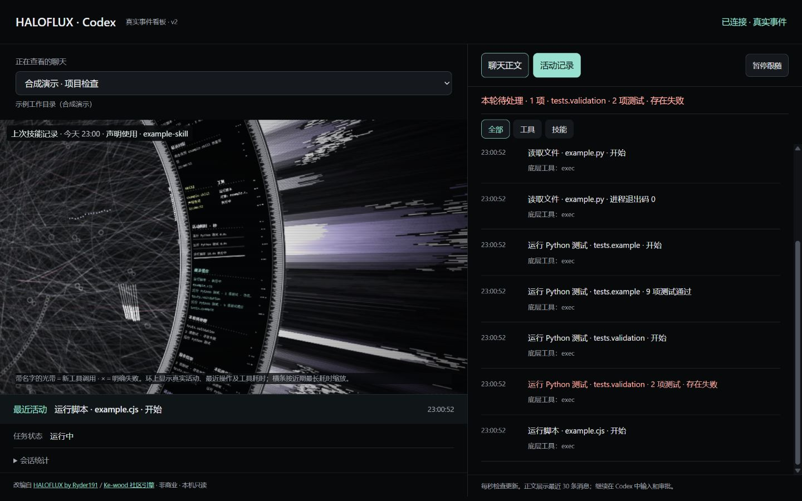

# HALOFLUX · Codex

<p align="center">
  <a href="./README.md"></a>
  <a href="./README.en.md"></a>
</p>

把 Codex 本地会话活动映射到 HALOFLUX 光环的**独立实时看板**。在浏览器里看半圆光环、运镜、具体操作、执行对象和结果，右侧核对聊天与活动记录。

**预览版 `0.1.0-preview.1` · Node.js 22+ · 无第三方运行依赖 · 仅限非商业使用**



*预览图完全使用合成会话与示例文件名，不是真实聊天或训练数据。*

这是基于 HALOFLUX 修改的非官方 Codex 适配版，复用 DeepSeek Harness 社区版本的 Canvas 引擎。它读取本地日志，**不是 Codex 内置插件，也不是 DeepSeek Harness 插件包**；不会替换 Codex 桌面应用背景。

## 快速开始

1. 安装 [Node.js 22 或更高版本](https://nodejs.org/)。
2. 下载本仓库 ZIP 并解压，或下载 Releases 中的发行包。
3. **Windows：双击 `start.cmd`**。服务启动后自动打开浏览器；保持启动窗口开启，按 `Ctrl+C` 停止。
4. 在 Codex 中正常对话，在看板的下拉框中选择会话。

也可以从终端启动，无须运行 `npm install`：

```sh
git clone https://github.com/mobiusw/haloflux-codex.git
cd haloflux-codex
node cli.cjs --open
```

默认地址为 `http://127.0.0.1:43127/`。不希望自动打开浏览器时，运行 `node cli.cjs`。安装了 npm 的用户也可以运行 `npm start`。

### 自定义日志目录和端口

默认读取 `CODEX_HOME` 环境变量所指的目录；未设置时读取当前用户的 `~/.codex`：

```text
<Codex 主目录>/
├── sessions/                # 递归查找 rollout JSONL
└── session_index.jsonl      # 可选，用于显示会话标题
```

```sh
node cli.cjs --port 43128 --codex-home "你的 Codex 主目录" --open
node cli.cjs --help
```

`--codex-home` 指向包含 `sessions` 的主目录，不是 `sessions` 本身。没有索引文件时仍能发现会话，使用日志中的用户消息作为备用标题。没有日志时显示空状态，开始一次 Codex 对话后会自动检查更新。文件目录约每 10 秒重新扫描，页面约每秒获取所选会话状态。

服务只监听 `127.0.0.1`，不支持通过局域网或公网访问。Windows 已做本地运行验收；仓库包含 Windows、macOS、Linux 的 Node 22/24 CI 测试配置，其他平台的桌面组合仍应以实际 CI 和本机结果为准。

## 当前功能

| 功能 | 当前行为 |
|---|---|
| 会话选择 | 列出最近修改的最多 25 个会话，显示标题和工作目录；记住浏览器上次选择 |
| 聊天正文 | 显示最近 30 条用户／助手消息；以纯文本呈现，Markdown 不做富文本渲染 |
| 活动记录 | 最近 160 条事件；可筛选全部、工具或 skill；显示时间、动作、对象、结果和底层工具名 |
| 跟随与暂停 | 接近列表底部时跟随新记录；暂停只暂停看板，不会停止 Codex 或命令 |
| 最近活动 | 显示最近事件及其时间，点击进入活动记录 |
| 会话状态 | 显示日志中的运行、结束、中断或失败状态；运行态超过两分钟没有新日志时显示“等待新日志” |
| 可折叠统计 | 工具调用数、已完成调用数、日志累计 token、最后事件时间 |
| 动态光环 | 半圆构图、自动运镜、光束与背景网络；新工具触发光带，明确失败可出现 × 标记 |
| 语义文字面板 | 轮换显示 skill、历史读取、当前请求、最近回复、工具、操作结果、本轮待处理 |
| 最近操作 | 合并近期相同动作与目标，最多显示 3 类；不可识别的操作保留通用名称 |
| 活动耗时 | 显示近期调用的秒数；执行中刷新，结束后固定，横条按近期最长耗时缩放 |
| 新记录高亮 | 新面板内容短暂使用银紫色高亮和 `NEW`；初始化和恢复时不把旧记录当成新事件 |
| 宽度适配 | 按实际文字宽度截断或换行，保留分隔点线；窄窗口改为纵向布局 |
| 历史静默加载 | 初次打开、刷新、切换会话、暂停恢复不重播旧工具光带 |
| 动画暂停 | 暂停或连接中断时停止动画；尊重系统“减少动态效果”偏好 |

### 圆盘文字来自哪里

- **skill**：从助手的显式技能声明、匹配到的 `SKILL.md` 成功读取中提取；同名合并，保留最近 3 种技能。`声明使用` 与 `已读取指引` 是不同证据，后者不代表建议已实际执行。识别不是完整技能审计，可能漏记。
- **历史读取**：识别部分 `read_thread` 调用，显示可解析的会话标题、请求范围和时间；匹配到记忆文件读取时显示“本机记忆文件”。不会展示隐藏记忆或推理正文，也不能自动识别所有上下文来源。
- **当前请求／最近回复**：使用最近聊天的简短摘录；支持从附件消息中提取 `My request` 后的请求。
- **工具**：显示可识别的动作、实际目标文件／测试模块，以及日志状态或结果摘要。
- **操作结果**：优先展示近期可识别的测试摘要，否则显示最近明确的进程结果。它可能保留上一轮记录，不代表本轮刚发生。
- **本轮待处理**：只展示本轮中“明确失败、目标已识别、命令可可靠匹配重试”的操作；最多取 3 项进入圆盘轮换，右侧入口显示本轮数量。

圆盘面板会旋转和轮换，不保证同时可见，也不替代右侧活动记录。skill 和历史读取会跨轮保留，可结合时间判断新旧。

### 能识别哪些操作

识别基于工具名和有限的命令规则，不是通过额外模型生成描述。

| 输入形式 | 显示示例 |
|---|---|
| `Get-Content`／`cat` 读取普通文件 | `读取文件 · example.py`，支持引号内的空格与中文 |
| 读取已匹配的 `skills/<名称>/SKILL.md` | `读取 skill · skill-name` |
| 独立 `apply_patch` 调用 | `修改文件 · example.py` |
| `node example.test.cjs` 等已匹配的测试文件 | `运行测试 · example.test.cjs` |
| `node --check example.js` | `语法检查 · example.js` |
| `node example.cjs` | `运行脚本 · example.cjs` |
| `python -m unittest tests.example`、`python -m pytest tests/example.py`、`pytest …` | `运行 Python 测试 · …`，也支持部分 `py`／Python 可执行路径形式 |
| 测试命令将 `.ipynb` 路径作为独立参数传入 | `运行 Notebook 测试 · 示例.ipynb` |
| `python -c` 的代码包含 `exec(...)`，随后传入 `.ipynb` 独立参数 | `运行 Notebook · 示例.ipynb` |
| 已匹配的浏览器打开、刷新、截图 | `打开页面`／`刷新页面`／`查看截图` |
| 同一次编排调用多个子工具，或检测到 shell 复合命令 | `批量工具调用`／`批量命令`；不把整体失败归给第一个目标 |
| 其他形式 | `运行命令`／`调用工具`，保留底层工具名供核对 |

Notebook 规则不限定具体文件名，但限定启动命令形式。直接在 Jupyter 或 VS Code 点击“运行单元格”，通常不会产生可供本看板识别的 Codex 调用事件。

**文档语言切换不会改变界面语言。** 当前看板标签和生成的操作描述仍以中文为主。

### 操作结果与待处理

- 解析结构化退出码、明确错误标志，以及部分命令结束元数据。普通输出中出现 `error` 或代码样例里的 `exit_code: 1`，不会单凭这些词判定失败。
- 对已识别的测试操作，可从标准 `unittest`／部分 `pytest` 汇总中提取测试数量；例如“9 项测试通过”。其他测试框架通常只显示进程退出码。
- **进程退出码 0 不等于业务结果正确**。缺乏可靠证据时显示“结果未确认”，不自动当作成功。
- 同一工作目录中的完全相同命令重试明确成功后，撤下对应待处理项，保留“已解决”事件。命令改写后不会自动推断为同一问题；其他命令成功也不会清除它。
- 旧轮次失败不混入“本轮待处理”；失败及解决记录仍受活动列表的最近 160 条限制。对象无法识别、批量编排或缺乏可靠重试标识的失败只记入活动历史。
- 尚未接入等待授权／等待用户输入的独立状态；长时间没有日志不会被判定为卡死。

## 数据真实性与限制

1. **真实数据层**：来自本机 Codex JSONL 的消息、工具调用、时间戳、已识别 skill／历史读取及 token 字段。看板不能看到日志中没有的事件。
2. **视觉表现层**：背景网络、粒子、光束形状、亮度及运镜是程序生成的艺术效果，不代表神经元、思考强度、完成百分比或训练质量。没有 SIM 波形／随机十六进制数据面板，新增步骤刻度盘和相位圆环也未启用。
3. **不是模型训练看板**：尚未接入 epoch、loss、RankIC、梯度或股票交易指标；没有自动执行 Notebook 或训练的功能。
4. **读取时机**：每秒轮询所选会话并增量解析，但端到端延迟取决于 Codex 何时写日志；不是模型逐 token 的实时流。
5. **状态口径**：调用耗时包括外层工具／进程开销；日志里的“完成调用”不等于完成一项业务任务。累计 token 直接展示日志字段，不是价格、账单或本轮净用量；没有准确 tok/s 与上下文占比。
6. **格式兼容性**：适配现有的 `session_meta`、`turn_context`、`event_msg`、`response_item` 等本地日志结构；未来 Codex 改格式时可能需要更新。
7. **保留上限**：最近 30 条消息、80 条工具记录、160 条活动、160 条技能证据；动画工具队列 40 项、回答显示分段队列 512 项。高事件量下可能跳过部分动画，列表与命令原始输出是核查依据。

## 隐私与网络

- 不需要 API key，不调用 OpenAI／其他模型 API，不自行增加模型 token 消耗；但浏览器动画会使用本机 CPU／GPU。
- 仅从选定 Codex 主目录读取会话及会话索引，不写回日志、不读取 `auth.json`、不读取浏览器 Cookie。
- 前端只请求当前本地服务，不包含遥测、外部字体或 CDN 运行依赖；页面中的上游链接仅在用户点击后访问。
- 原始工具参数、输出正文和隐藏推理不发送到前端；仅投影已识别字段和有限结果摘要。**聊天正文、工作目录、目标文件名和部分技能声明证据会在本机页面显示**，截图或分享时请自行检查。
- 校验 Host 与请求 Origin，仅提供 GET 接口，不开放跨域访问；静态文件使用固定允许列表。这不是具有账号登录的多用户服务，不要自行反向代理到公网。

## 测试与开发

```sh
node scripts/test.cjs
# 或
npm test
```

测试不需要 Codex 登录或模型调用，使用合成事件与自动清理的临时目录。覆盖生命周期、去重、失败优先级、暂停恢复、会话隔离、skill 证据、命令对象、批量归属、结果摘要、待处理与成功重试、150 组排字组合、新事件高亮，以及本地 HTTP 的只读／Host／Origin 检查、中文增量解码、日志截断与空目录启动。

```text
cli.cjs / start.cmd     启动入口
server.cjs              本地 HTTP 服务、会话扫描和增量读取
parser.cjs              日志事件解析
actions.cjs             动作、对象和重试标识
results.cjs             有限结果摘要
skills.cjs / recall.cjs  技能与历史读取证据
app.js / index.html     会话、正文、活动列表与条件提示
bridge.js               日志快照到圆盘内容的适配
engine.js               HALOFLUX Canvas 渲染引擎（修改版）
live-halo.html          圆盘宿主页面与固定展示参数
```

## 常见问题

**打不开页面？** 保持服务终端开启，确认输出的本地地址。端口已占用时换用 `--port 43128`；关闭窗口／按 `Ctrl+C` 会停止服务，没有设置开机自启。

**没有会话？** 确认当前 Codex 确实在本机写入 `sessions/*.jsonl`，自定义目录用 `--codex-home` 指定；远程机器上的会话不会自动同步到本机。

**还会看到 `exec` 或 `js`？** 它们是日志中的底层工具名。无法可靠识别动作时保留通用名称，不猜测具体文件操作；也不拆解任意 JavaScript 编排代码。

**打开后没看到新光束或圆盘较暗？** 历史初始化不会重播旧活动；运行新任务才会产生新事件。空闲时动画会收敛，减少动态效果偏好也会影响显示。

**能用于 Claude Code 或直接当桌面背景吗？** 当前没有这两项集成。它是 Codex 本地日志的独立浏览器看板。

## 来源、署名与许可

本项目是 **HALOFLUX 的修改版**，不是 OpenAI、DeepSeek 或上游作者的官方产品。

- 原作：**HALOFLUX by Ryder191 (RYDER CODE / Ms MAIKEBAIs CAT)** — <https://github.com/Ryder191/haloflux>
- Canvas 社区适配来源：**Ke-wood / dsh-haloflux** — <https://github.com/Ke-wood/dsh-haloflux>，本项目基于其独立引擎 v0.7.1 的本地修改版。
- 本项目新增／修改：Codex 本地只读适配、独立页面与启动方式、语义圆盘面板、结果与待处理识别、布局及测试。

保留上游 `LICENSE` 和 `NOTICE`。**仅限非商业用途**，不是 MIT／Apache 授权；使用、修改和再分发须遵守随附许可证及必需署名。不得据此宣称可用于商业产品或公司内部商业用途。

Required Notice: Copyright (c) 2026 Ryder191 (RYDER CODE / Ms MAIKEBAIs CAT) - https://github.com/Ryder191/haloflux

Required Notice: Noncommercial use only. Any commercial use is strictly prohibited. No commercial licenses are offered.
